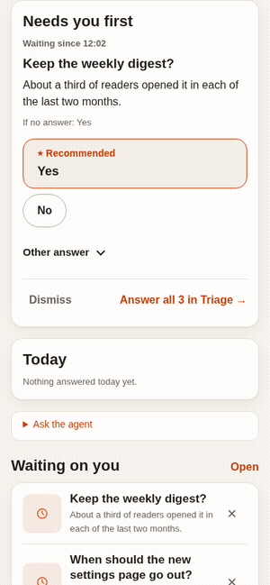
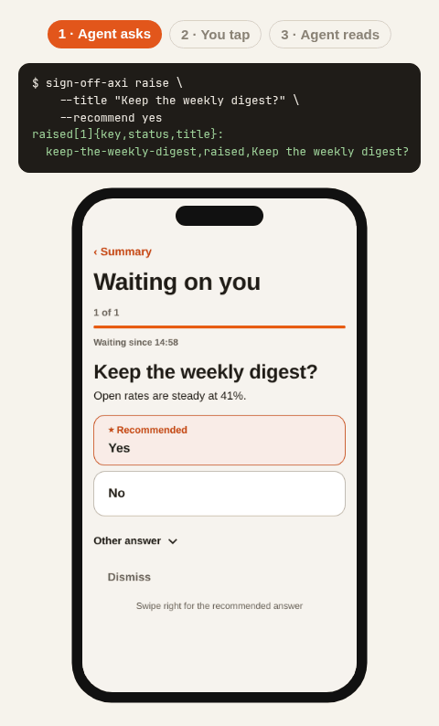

<p align="center"><b>▶ <a href="https://umeranjum17.github.io/sign-off/">Try it live</a></b> — the real board on demo data: tap an answer and watch it save. No install, nothing leaves your browser.</p>

<p align="center">
  
</p>

<p align="center">
  
</p>

<h1 align="center">sign-off</h1>

<p align="center"><b>One calm page for every question the programs working for you need answered.</b><br>Yes or no, pick-one, mock-ups, proof photos, short videos, sign-in links: each lands on a board on your own machine, you answer with one tap, and the answer is saved for the asker to read.</p>

<p align="center">
  <picture>
    <source media="(prefers-color-scheme: dark)" srcset="docs/media/hero-dark.gif">
    
  </picture>
</p>

## One-minute quick start

```sh
npm install -g sign-off-axi
sign-off-axi raise \
  --title "Keep the weekly \
digest?" \
  --why "The paid plan \
renews Monday." \
  --outcome yes="It keeps \
going out." \
  --outcome no="It stops \
this week." \
  --recommend yes \
  --recommend-reason "Readers \
still open it." \
  --default yes
sign-off-axi open
```

Open the printed URL, click **Yes**, then read the answer back the way an
agent would:

```sh
sign-off-axi answers \
  --key keep-the-weekly-digest
```

That is the whole loop: the agent raises, you tap, the agent reads.
Every question says why it is asked, what each answer does, which one the
agent recommends and why, and what happens if you stay quiet; a question
that does not is refused before it reaches you (see
[the question standard](docs/contract.md#ask-schema-1)). The
board is the default one (`~/.sign-off/decisions.json`); name a file after
any command to use another board.

## What you can ask

One line on what the agent runs, one screenshot of what you see. The full
reference for each kind lives in [docs/question-kinds.md](docs/question-kinds.md);
the message rules are in [docs/contract.md](docs/contract.md).

### Yes or no

```sh
sign-off-axi raise \
  --title "Keep the weekly \
digest?" \
  --about "Open rate held \
steady at about a third \
for two months." \
  --why "The paid plan \
renews Monday." \
  --outcome yes="It keeps \
going out each Monday." \
  --outcome no="It stops \
after this week." \
  --recommend yes \
  --recommend-reason "Readers \
still open it." \
  --default yes \
  --silent-by 2026-10-19T09:00Z
```

<picture>
  <source media="(prefers-color-scheme: dark)" srcset="docs/media/kind-yes-no-dark.webp">
  
</picture>

*A yes/no ask. The recommended answer is marked.*

### Pick one, with a recommendation

```sh
sign-off-axi raise \
  --title "When should \
the new settings \
page go out?" \
  --about "No new \
bug reports for three \
weeks." \
  --why "Support is fully \
staffed on Friday." \
  --option today=Today \
  --option friday=Friday \
  --option next-week="Next \
week" \
  --outcome today="It goes \
out now." \
  --outcome friday="It goes \
out with support on hand." \
  --outcome next-week="It \
waits a week." \
  --recommend friday \
  --recommend-reason "Support \
can answer questions." \
  --default next-week
```

<picture>
  <source media="(prefers-color-scheme: dark)" srcset="docs/media/kind-pick-one-dark.webp">
  
</picture>

*Pick one of three. Friday is recommended; silence means next week.*

### Design pick, with mocks A/B/C

```sh
sign-off-axi post \
  --type design \
  --title "Pick the settings \
layout" \
  --option a="Layout A" \
  --option b="Layout B" \
  --option c="Layout C" \
  --mock a=mocks/a.html \
  --mock b=mocks/b.html \
  --mock c=mocks/c.html \
  --tradeoff "A is fastest \
to tap; B shows both \
choices; C fits small \
screens." \
  --recommend b
```

<picture>
  <source media="(prefers-color-scheme: dark)" srcset="docs/media/kind-design-dark.webp">
  
</picture>

*Three layouts side by side. Layout B is recommended.*

### Proof update, with Pass / Fail / Needs work

```sh
sign-off-axi post \
  --type evidence \
  --title "Settings page \
loads in a second" \
  --about "Umer opens \
the new page on a phone." \
  --media shot-light.png \
  --media shot-dark.png
```

<picture>
  <source media="(prefers-color-scheme: dark)" srcset="docs/media/kind-evidence-dark.webp">
  
</picture>

*Proof of a fix, with two captures. Pass, Fail, or Needs work.*

Evidence lists passed proof only: an update whose linked run passed. A plain update like this links no run, so it waits in **Waiting on you** instead, as does a failed or unchecked run, each with its honest result and its verdicts and Dismiss, so the agent still gets an answer. Passed updates are grouped by the project named in the run's proof line, `verify-<project>: ...` (trimmed, compared without case); a proof line with no such prefix goes under **Other**.

### Explainer video, with chapters

```sh
sign-off-axi post \
  --type explainer \
  --title "Is the new \
sign-in clear?" \
  --about "Two steps: \
password, then a code." \
  --media explainer.mp4 \
  --chapter 0:00=Start \
  --chapter 0:02="The tap"
```

<picture>
  <source media="(prefers-color-scheme: dark)" srcset="docs/media/kind-explainer-dark.webp">
  
</picture>

*A short video with chapters, then Yes or No.*

### Explainer page, to read

```sh
sign-off-axi report init \
  .sign-off/mocks/sign-in
d=mocks/sign-in
sign-off-axi post \
  --type report \
  --title "Sign-in now \
takes 2 steps" \
  --about "Why the code \
step moved first." \
  --view $d/index.html \
  --preview $d/preview.svg
```

<picture>
  <source media="(prefers-color-scheme: dark)" srcset="docs/media/kind-report-dark.webp">
  
</picture>

*An explainer page to tap through and read.*

### Diagram

```sh
sign-off-axi post \
  --type diagram \
  --title "Is this the \
sign-in flow?" \
  --about "Password first, \
then a code, then in." \
  --view flow.svg \
  --recommend yes
```

<picture>
  <source media="(prefers-color-scheme: dark)" srcset="docs/media/kind-diagram-dark.webp">
  
</picture>

*A question drawn as a three-box flow.*

### Interactive page

```sh
sign-off-axi post \
  --type interactive \
  --title "How many \
testers approved?" \
  --about "Tap the counter \
to add yourself." \
  --view counter.html \
  --option yes=Yes \
  --option no="Needs \
work" \
  --recommend yes
```

<picture>
  <source media="(prefers-color-scheme: dark)" srcset="docs/media/kind-interactive-dark.webp">
  
</picture>

*A live counter to tap, in a sandboxed page.*

### Sign-in link

```sh
sign-off-axi post \
  --type signin \
  --service "npm" \
  --link \
https://example.com/abc123 \
  --unlocks "Publish \
the release" \
  --waits "Umer" \
  --expires 15m \
  --key npm-login
```

Later, when it worked:

```sh
sign-off-axi signin done \
  --key npm-login
```

<picture>
  <source media="(prefers-color-scheme: dark)" srcset="docs/media/kind-signin-dark.webp">
  
</picture>

*A sign-in card: what it unlocks, who waits, the time left.*

### Release gate

```sh
sign-off-axi post \
  --kind gate \
  --from gate.json
```

A `gate.json` holds a run for the user: Approve or Fix first.

<picture>
  <source media="(prefers-color-scheme: dark)" srcset="docs/media/kind-gate-dark.webp">
  
</picture>

*A held run: Approve it or Fix first.*

### Retro finding

```sh
sign-off-axi post \
  --kind finding \
  --from finding.json
```

A `finding.json` asks the user to Apply or Skip a proposed fix.

<picture>
  <source media="(prefers-color-scheme: dark)" srcset="docs/media/kind-finding-dark.webp">
  
</picture>

*A retro fix to Apply or Skip.*

## On your phone

The same board on a phone, light and dark.

<picture>
  <source media="(prefers-color-scheme: dark)" srcset="docs/media/phone-dark.webp">
  
</picture>

*The summary, the waiting list, and the answers, in a phone frame.*

## On your screen

The waiting list and the summary at desk width, light and dark.

<picture>
  <source media="(prefers-color-scheme: dark)" srcset="docs/media/desktop-dark.webp">
  
</picture>

*Everything in one glance: waiting, evidence, explainers, answered.*

## How agents use it

Every item records who filed it, and that agent gets the answer as an
event, by itself: the agent raises with `--filer my-agent` and blocks on
`sign-off-axi wait --filer my-agent`, which returns only that filer's
answers, each once, and the card shows **Seen by agent**. An agent that
cannot block can be woken instead: an `on_answer:` line in the
`config.yaml` beside the board names a command the board runs for every
answer. A `notify:` block in that config can send an HTTP POST when a card
enters Waiting on you, with its bearer token read from a named environment
variable, or, with `receiver: muxr`, from the muxr host's `notify-token`
file; `sign-off-axi notify test` sends a test notice. The full reference, with the worked example, is in
[docs/commands.md](docs/commands.md).

Every command takes `--help` and prints compact output with next-step hints.
sign-off itself calls no model and inherits the calling agent's model routing.

## Install

```sh
npm install -g sign-off-axi
```

In a project folder, one command sets up `.sign-off/` and installs the
skill for each coding agent on your `PATH`:

```sh
npx -y sign-off-axi init
```

## Docs and reference

- [Commands](docs/commands.md): every command, the agent setup, exit codes.
- [Question kinds](docs/question-kinds.md): the reference for each kind.
- [Contract](docs/contract.md): the message rules agents post by.
- [File formats](docs/file-formats.md): board and message files.

## Development

Builds first, then runs the integration journeys against the real CLI:

```sh
npm test
npm run build:skill
npm run build:demo
npm pack
```

- `npm test`: full journeys
- `npm run build:skill`: skill stub
- `npm run build:demo`: demo site (Try it live)
- `npm pack`: tarball

A release is a merged version-bump PR: CI publishes the new version to npm.

### Test runs never touch your board

With no board named, a bare command uses the nearest `.sign-off/` that
`init` set up, looking from the working folder up to its repo root (the
folder holding `.git`) or up to HOME, but never HOME's own `.sign-off/`.
Otherwise the default board is `~/.sign-off/decisions.json`, under
`SIGN_OFF_HOME` when it is set. A test or agent run that must not reach your
own board sets HOME and every `XDG_*` folder to one fresh temporary folder,
or sets `SIGN_OFF_HOME` to one. A board file named on the command line
always wins.

```sh
tmp=$(mktemp -d)
export SIGN_OFF_HOME="$tmp"
(cd "$tmp" &&
  sign-off-axi raise \
  --title "Probe?")
```

Proof lives in [`.done-done.yaml`](.done-done.yaml): the `install`, `test`
and `skill` journeys re-run every check the CI gate enforces, and CI calls
them through `done-done run`.

Write your own questions using the [file-format reference](docs/file-formats.md).
