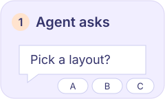
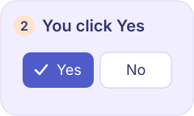
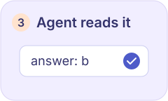
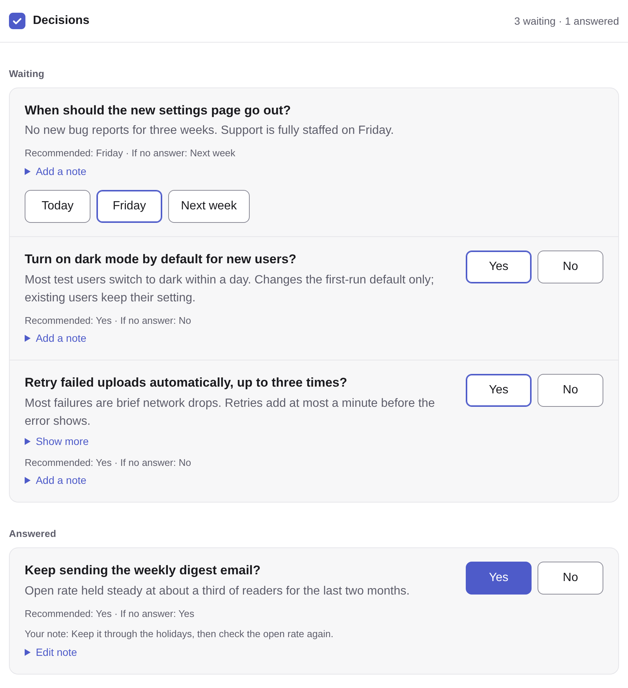
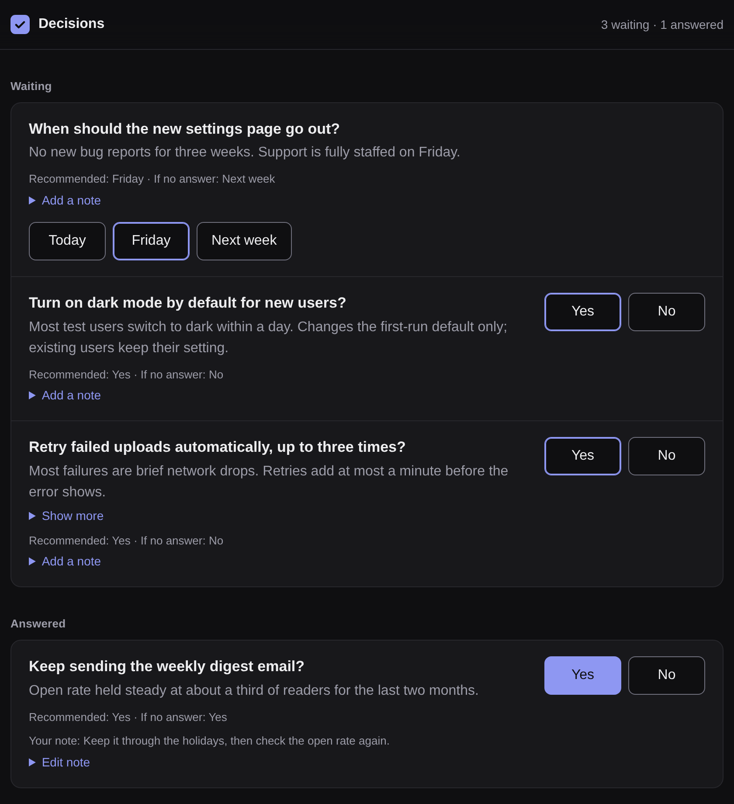
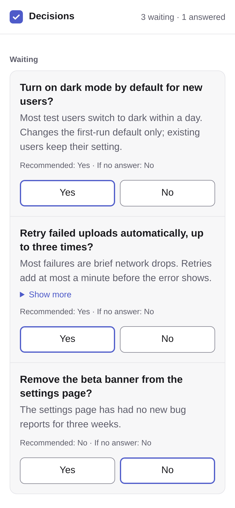
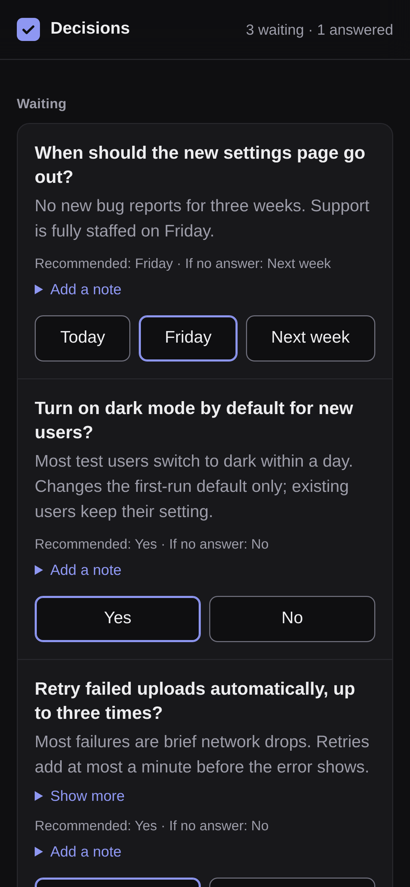

<p align="center">
  
</p>

<h1 align="center">sign-off</h1>

<p align="center"><b>Answer your agents' yes/no and pick-one questions in one click, from a page on your own machine.</b></p>

<p align="center">
  
  
  
</p>

<p align="center">
  
</p>

## Why

Agents stop and ask: ship this, keep that, turn this on? Those questions scatter across terminals and chats, and an answer typed in the wrong place gets lost.

sign-off puts them on one calm list. The agent writes a small JSON file, you inspect the linked evidence, click **Yes** or **No** (or one of up to six choices the agent offers), and the answer is saved next to the file for the agent to read. Add an optional short note if the agent should know why; the note never blocks the click. It runs on your own machine (`127.0.0.1`, or one private address you name with `--bind`): no account, no hosting.

Your answer survives reloads and restarts; you can change it with one more click. Recommendations and silent defaults are shown, never applied for you.

## Quick start

### Agent skill (recommended)

sign-off works with whichever coding agent you use; it names no vendor, model or account, and calls no model itself. In a project folder:

```sh
npx -y sign-off-axi init
```

`init` writes the repo setup (below) and installs the sign-off skill for every coding agent whose command is on your `PATH`. Detection reads nothing else (no logins, no network); the install then fetches the skill from this repository. Pick agents yourself with `--agent` (one name, or several joined by commas); the choice is saved as `agent:` in `.sign-off/config.yaml`, and `sign-off-axi doctor` then prints one line per agent saying whether its skill is installed, with the install command when it is not.

| Agent | `--agent` name | Detected by | Skill folder in the project |
|---|---|---|---|
| Claude Code | `claude-code` | `claude` | `.claude/skills/` |
| Codex | `codex` | `codex` | `.agents/skills/` |
| OpenCode | `opencode` | `opencode` | `.agents/skills/` |
| Pi | `pi` | `pi` | `.agents/skills/` |
| Gemini CLI | `gemini-cli` | `gemini` | `.agents/skills/` |

The install is the multi-agent [`npx skills`](https://github.com/vercel-labs/skills) installer for the [Agent Skills](https://agentskills.io) format, so you can also run it by hand, for any agent it supports:

```sh
npx skills add umeranjum17/sign-off --skill sign-off-axi -a <agent>     # add -g to install for all your projects
```

That is the entire setup - no npm install needed.
The skill teaches your agent to run sign-off through `npx -y sign-off-axi`, so the CLI comes along on demand.
It stays a short stub and sends the agent to `npx -y sign-off-axi --help` for current instructions, so an installed copy cannot go stale against a newer CLI.
Its frontmatter also includes Hermes Agent metadata, so Hermes-compatible harnesses can categorize and surface it as a first-class productivity skill.

Then ask in plain words - "ask me whether to keep the weekly digest and wait for my answer" - and the agent loads the skill on its own when it recognizes the task. Agents that expose skills as slash commands also take `/sign-off-axi should we keep the weekly digest?`.

### Your answer reaches the agent that asked

Every item records who filed it, and that agent gets your answer as an event, by itself:

```sh
npx -y sign-off-axi raise --title "Keep the weekly digest?" --filer my-agent   # or export SIGN_OFF_FILER=my-agent
npx -y sign-off-axi wait --filer my-agent                                      # blocks until you answer, then prints it
```

`wait --filer` returns only answers to that filer's items, each once, including one given before it started waiting; the card then shows **Seen by agent**. With no `--filer` or `SIGN_OFF_FILER`, a post saves the Claude Code session id when there is one, and the post prints the exact `wait` command to run. An agent that cannot block can be woken instead: an `on_answer:` line in the `config.yaml` beside the board names a command the board runs for every answer (below).

### Repo setup

In a project folder, `sign-off-axi init` writes `.sign-off/` (config with the
board, port and agent choice, an empty board, `mocks/` and `evidence/` folders,
and a `.gitignore` keeping media and answer files out of git) and
`sign-off-axi doctor` checks it: node version, config, board, answer files,
a lock a crashed command left behind, gitignore lines, folders, the dashboard
port, the `hosts:` names and each agent's skill. Each
failure prints one `help:` line with its fix, and doctor exits 1; a clean run
exits 0. `open` and `serve` use the config's `port:` unless `--port` is given;
for a symlinked board they read the `config.yaml` beside the link, as doctor does. With no folder, `doctor` checks the nearest setup the same way a bare command finds its board.
Re-running `init` keeps files that are already there, adds the missing ones (so
it repairs an `init` that was cut short) and skips agents that already have the
skill. Mock files go under
`.sign-off/mocks/` and are named board-relative in `post` (for example
`mocks/a.html`). The skill tells the agent how to make them: 3 variants that
differ in structure, a short trade-off and one recommendation, posted, waited
on and read back.

Boards written by 0.1.0 (`"schema": 1`, including `~/.sign-off/decisions.json`)
still read, with their saved answers, and are upgraded on the first write that
changes them. The format is in [docs/file-formats.md](docs/file-formats.md).

### Manual CLI

The skill is the recommended path, but you can also run the board by hand from this repository (Node 22.5 or newer):

```sh
# 1. Build
git clone https://github.com/umeranjum17/sign-off && cd sign-off && npm install && npm run build

# 2. Open the page with the demo questions (copy them so the answers stay out of the repo)
cp fixtures/demo-decisions.json /tmp/decisions.json
node dist/cli.js serve /tmp/decisions.json       # prints http://127.0.0.1:4410/
# Optional: add --evidence-root /path/to/project-store to read proof records/media (the root containing .done-done/)

# 3. Click an answer, then read it back the way an agent would
node dist/cli.js answers /tmp/decisions.json     # answers[1]{key,answer,at}: weekly-digest,yes,...
```

## Commands

The CLI is `sign-off-axi`, an [AXI](https://axi.md): agents drive it from a shell with no setup. It prints compact [TOON](https://toonformat.dev) on stdout with next-step hints, and every command takes `--help`.
sign-off itself calls no model and inherits the calling agent's model routing.

```
sign-off-axi                       list the decisions waiting on the user (same as list)
sign-off-axi raise --title "<question>" [--key <key>] [--about <text>] [--detail <text>]
                    [--option <value>=<label>]... [--recommend <value>] [--default <value>] [--close done|release]
sign-off-axi raise --from <decisions.json>      add every decision in a decisions file (a new item of a contract kind carries `contract`, `kind` and `schema`: see docs/contract.md)
sign-off-axi post --kind <kind> --from <message.json|->   post one contract message, from a file or stdin
sign-off-axi post --type design --title "<question>" [--option <value>=<label>]... [--mock <value>=<path>]...
                    [--tradeoff <text>] [--recommend <value>]   ask for a pick between mocks, shown side by side
                                                (--type decision is the same as raise; raise stays its alias)
sign-off-axi post --type evidence --title "<what this shows>" --about "<short note>" --media <file>... [--link <commit or URL>]
                                                post the next numbered evidence update for a pass/fail/needs-work verdict
sign-off-axi post --type diagram|interactive --title "<question>" --view <path> [--option <value>=<label>]...
                                                ask with a diagram image, or a sandboxed interactive .html page
sign-off-axi post --type explainer --title "<question>" --media <video> [--about <summary>] [--chapter <m:ss>=<title>]...
                                                ask with a narrated video the agent made with free local tools
sign-off-axi init [dir] [--agent auto|<name>]   write the repo setup under <dir>/.sign-off/ (config, board, mocks/ and evidence/ folders)
                                                and install the skill for each chosen coding agent (auto: each one on PATH)
sign-off-axi doctor [dir]                       check that setup and each agent's skill; every failure names its fix
sign-off-axi validate <message.json>... [--kind <kind>] [--expect-invalid]   check ask and report messages against the contract (docs/contract.md) without posting
sign-off-axi open  [--port 4410] [--bind <address>] [--evidence-root <dir>]   start the board in the background; prints its URL and pid
sign-off-axi status                             is the board open started for this file running? its URL and pid
sign-off-axi stop                               stop that board
sign-off-axi serve [--port 4410] [--bind <address>] [--evidence-root <dir>]   run the board in the foreground (--port 0 picks a free port)
sign-off-axi answers [--key <key>]              the latest answer per decision, and how many still wait
sign-off-axi wait [--filer <id>] [--key <key>] [--timeout 600]  block until the user answers, then print it like answers
                                                (--filer: only that filer's items; without --key each answer once)
sign-off-axi poll [--timeout 600]               block until the user comments or queues a prompt, then print each new one once
sign-off-axi export [--out <file.html>]          write a frozen read-only copy of the board as one HTML file
```

- The board is the one you name right after the command (`sign-off-axi answers ./decisions.json`). With none, it is the nearest `.sign-off/` board that `init` set up, found by the walk described in [Test runs never touch your board](#test-runs-never-touch-your-board); otherwise the default board there (`~/.sign-off/decisions.json`, or under `SIGN_OFF_HOME`). Answers are saved next to it.
- Next-step commands in the output name paths under the working folder relative to it, and say `npx -y sign-off-axi` when sign-off-axi runs through `npx`.
- `post --type design` asks for a pick between up to 6 mock options, each with an optional `--mock <value>=<path>` file (`.html`, `.svg`, `.png`, `.jpg`, `.jpeg`, `.webp`) shown as a tall phone frame above its button (the recommended one first; on a phone the frames swipe sideways, the next one peeking in, and a tap opens one full size), plus a `--tradeoff` line and a `--recommend` badge. Mock paths are relative to the board file's folder and never escape it. One `.html` page can hold every variant: `--mock a=mocks/<key>/index.html?variant=a` loads the page with `?variant=a`. An `.html` mock or view loads the css, scripts, images and fonts beside it by relative name (`style.css`, `img/dot.png`), from its own folder only, never anything above it. The board adds a small pointing script to each `.html` mock: once the board turns it on for that frame, a tap on a part of the mock is kept from the mock and named back to the board as a path to that element, its tag and its words; it passes only text and gives the mock no reach into the board. With **Comment on the mocks** on, a tap opens a comment on that element: one per element, listed under the mocks with Edit and Delete, kept on the board and shown, until it is sent, only on the exact mock file it was made on. The comments go to the agent with the next answer on that card (a pick, Other answer or **Another round**, which may then have no note), each with its element, in `wait` and `answers` (`comments`); once sent they are listed as sent and can no longer change. An option with no mock, or whose file is gone, says "No mock for this option". `post --type decision` (the default) is exactly `raise`, and `raise` stays as its alias.
- `post --type evidence` posts the next numbered update (`update-1`, `update-2`, ...) with 1 to 12 screenshots or recordings (`.png`, `.jpg`, `.jpeg`, `.webp`, `.mp4`, `.webm`, up to 50 MB each), a short note and an optional commit or PR link. The files are copied into `evidence/<number>/` next to the board, so the board is the store: no hosted service. The page shows the updates newest first; each file is served only while its size and SHA-256 still match what was posted, and recordings play inline on a phone. The person gives a verdict, **Pass**, **Fail** or **Needs work**, with an optional note, read back with `answers` or `wait --key update-<number>`.
- `post --type diagram` and `post --type interactive` show a question with a picture: `--view <path>` names one board-relative file, an image (`.svg`, `.png`, `.jpg`, `.jpeg`, `.webp`) drawn at card width for a diagram, or one self-contained `.html` page that runs in a sandboxed frame for interactive. Every mock and view is served under a Content-Security-Policy with no `fetch`, no remote files and no access to the dashboard or its tab. They answer like a decision.
- `post --type explainer` shows a question with a narrated video the agent made itself (stills plus speech from a free local engine such as piper or espeak-ng, joined with ffmpeg; the skill has the recipe). `--media` names one `.mp4` or `.webm`, copied into `evidence/<number>/` and served hash-checked like evidence media; it plays on the card with its own controls, at phone width too. `--about` is a short summary and each `--chapter m:ss=<title>` is a button that plays the video from there. sign-off itself never makes the video: it calls no speech engine, no ffmpeg and no network service.
- The person can also tap **Another round** inside **Other answer** (with the typed note), which wakes a waiting agent the same way an answer does; the agent reads it back in `answers --json` under `rounds`, with any comments on mock elements it carried.
- **Dismiss** (the × on an item in a list, **Dismiss** under Needs you first and beside **Skip for now** in Triage, or **Clear all done** on Answered) hides items from the board, Today included; **Undo** in the toast brings them back, and so does **Restore** under **Dismissed (N)** at the end of Needs you first and Triage. The agent is not told, so an ask it waits on keeps waiting. The storage is in [docs/file-formats.md](docs/file-formats.md).
- The person can comment on any item (**Send as a comment**, also inside **Other answer**: each card has that one place to type) and queue a free-text prompt for the agent (**Ask the agent**). `poll` blocks until one arrives and prints every new one once (`--json` prints `{"messages":[{"id","kind","key"?,"text","at"}]}`); the page then shows it as read by the agent. Typed notes that are not sent yet stay in the browser across reloads; everything sent is saved next to the board and survives a restart.
- The board runs on your own machine only: no hosted service, no recurring cost. It listens on `127.0.0.1` unless `--bind <address>` (or `bind:` in the `config.yaml` that `init` writes) names one private address of this machine, such as its VPN address, so a phone or tablet on your own network can open it. A `hosts:` line in that config names private DNS names that lead to the bind address, such as its mesh VPN name (commas between them), so the board also opens by name; `doctor` checks each one resolves to the bind address. All interfaces and public addresses are refused. Beyond `127.0.0.1` the board makes an access token once (`decisions.token`, mode 600, next to the board), `open` prints it in the link, and every request without it is refused; the link sets a cookie, so the page and its media work after the first load. Delete the token file to shut old links out at once, then `stop` and `open` for a new one.
- `export` writes one self-contained HTML file (`decisions.export.html` by default): every item, answer, note and another-round request with its local mocks and media inlined; comments and queued prompts are left out. `--out` must end in `.html`, so a wrong path never overwrites the board. It opens from disk with no server, is read-only, and makes no network request. A mock page is inlined on its own, so the css and images beside it show only on the running board.
- With no `--option` a question is Yes/No; give 2 to 6 `--option` flags for a pick-one question (`--option friday=Friday --option next-week="Next week"`). `--recommend` and `--default` name one of its values. Listing options needs `--recommend` (on `raise`, `post` and `--from` files): the board shows that option first and marks it; a plain Yes/No may leave it out. Each answer is one tap, with an Undo for a few seconds after it (an Undo is saved as an answer change). Typing is last: every question with options, a design's Picks included, has a text box folded behind **Other answer** (none when an option is valued `text`); the words are saved as the answer `text`, with the same Undo.
- `list` and `answers` take `--full` for every field and `--json` for JSON (`answers --json` prints `{"<key>":{"answer","label","close","at"}}`, plus `"note"` when the user wrote one). `answers` adds a note column when any shown answer has a note.
- Raising a question that is already on the board is a no-op that reports its status, so an agent can re-run it safely. `--key` defaults to a slug of the title.
- Each raised or posted item records when it was filed (`filed`), so Triage shows `Waiting since 09:15` and the Waiting on you tile `Oldest 09:15`; `post --replace` keeps an item's first time.
- `open` is a no-op when the same board is already open on the same address, and fails with `CONFLICT` when it runs on another one. `--evidence-root` is the folder holding `.done-done/`, for decisions that link run evidence.
- `--filer <id>` on `post` and `raise` saves who filed the item (an agent session id or any 1-128 of `A-Z a-z 0-9 . _ -`; `SIGN_OFF_FILER` sets it for every command, and a post with neither saves `CLAUDE_CODE_SESSION_ID` when it is set). `wait --filer <id>` then returns only answers to that filer's items it has not taken yet, marks each taken (`decisions.seen.jsonl`) and the card shows **Seen by agent**; it fails with `NOT_FOUND` when none of that filer's items is answered or waiting. The page never shows the filer id.
- `on_answer: <command> [args]` in the `config.yaml` beside the board runs that command for every saved answer, read when the board starts. It runs with no shell, in the board's folder, and gets the answer as one JSON line on stdin (`{"key","answer","label","close","at","note"?,"title"?,"filer"?,"comments"?}`, where `comments`, present when the answer carried comments on mock elements, lists each as `id`, `mock`, `hash`, `ref`, `tag`, `words` and `text`); the answer is never put into its arguments, so a typed note cannot inject a command. A failure is logged and never blocks the answer. With no shell, `|`, `>` and `&&` are passed as plain arguments, so put a pipeline in a script and name the script; a relative path such as `./hook.sh` is found from the board's folder. `doctor` checks that the command can run.
- `post --from <file> --replace --filer <id>` lets several programs feed one board: it replaces only that filer's items (and items with no filer that the file names by key), keeps every other item, the board's other top-level fields and all answers, and an empty items list removes that filer's items.
- `wait` replaces a polling loop. With `--key` it returns at once if that decision is already answered, and waits for a key that is not raised yet; without it, it waits for the next answer to any decision still waiting and fails with `NOT_FOUND` when nothing is. It wakes on each save, gives up after `--timeout` seconds (600, ten minutes, by default) with code `TIMEOUT` and exit 1, and takes `--full` and `--json` like `answers`. Ctrl-C stops it without changing anything.
- `open` records the board's pid, port and address next to the board file (`decisions.board.pid`). `status` and `stop` read it and only act on a pid that really serves that board, so no one has to guess a pid to kill. `open` on a board already served by `serve` records that server, so `stop` can close it too.

```
$ sign-off-axi raise --title "Keep the weekly digest?" --recommend yes
board: ~/.sign-off/decisions.json
raised[1]{key,status,title}:
  keep-the-weekly-digest,raised,Keep the weekly digest?
help[2]:
  Run `sign-off-axi open` so the user can answer
  Run `sign-off-axi answers --key keep-the-weekly-digest` to read the answer
```

Exit codes: `0` ok, including no-ops; `1` the request cannot be done (a key that already holds a different question, a busy port); `2` usage or input error (the message names the item, key and field). Errors print on stdout as `error:`, `code:` and `help:` lines.

Write your own questions using the [file-format reference](docs/file-formats.md).

## On your screen

Real demo questions, with one Yes and its note already saved. Desktop shots are cropped to the list, not redrawn.

**Desktop · dark**



**Phone · light and dark**

<p>
  
  
</p>

## Development

```sh
npm test                      # builds, then runs the integration journeys against the real CLI and server
npm run build:skill           # regenerates skills/sign-off-axi/SKILL.md from src/skill.ts (CI runs it with -- --check)
npm pack                      # builds the publishable sign-off-axi tarball
```

### Test runs never touch your board

With no board named, a bare command uses the nearest `.sign-off/` that `init` set up, looking from the working folder up to its repo root (the folder holding `.git`) or up to HOME, but never HOME's own `.sign-off/`. The working folder's own `.sign-off/` is always used. A folder above it is searched only when that climb reaches a repo root or HOME, so a `.sign-off/` above a folder with neither (outside HOME, no `.git`) is never used, and the account's own home is never used. Otherwise the default board is `~/.sign-off/decisions.json`, under `SIGN_OFF_HOME` when it is set (it takes HOME's place for the default board and for where the climb stops), else under HOME.

A test or agent run that must not reach your own board sets HOME and every `XDG_*` folder to one fresh temporary folder, or sets `SIGN_OFF_HOME` to one. A board file named on the command line always wins, so name only a board inside the temporary folder, and spell it out in full: a `~` is expanded by the calling shell with its own HOME before `HOME=...` takes effect. Run the command from the temporary folder to keep project boards out too.

```sh
tmp=$(mktemp -d)
(cd "$tmp" && SIGN_OFF_HOME="$tmp" sign-off-axi raise --title "Probe?")   # lands in $tmp/.sign-off/decisions.json
```

Browser proof lives in [`.agents/skills/verify-sign-off`](.agents/skills/verify-sign-off/SKILL.md).
