<p align="center">
  
</p>

<h1 align="center">sign-off</h1>

<p align="center"><b>One calm page for every question the programs working for you need answered.</b><br>Yes or no, pick-one, mock-ups, proof photos, short videos, sign-in links: each lands on a board<br>on your own machine, you answer with one tap, and the answer is saved for the asker to read.</p>

<p align="center">
  
  
  
</p>

<p align="center">
  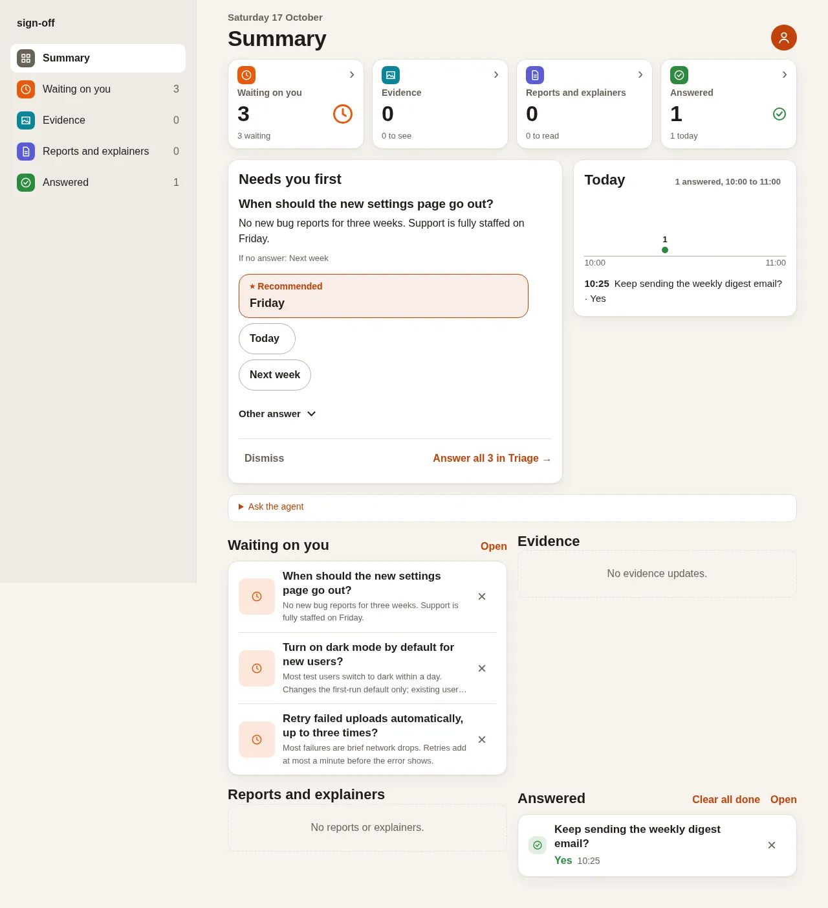
</p>

## One-minute quick start

```sh
npm install -g sign-off-axi
sign-off-axi raise --title "Keep the weekly digest?" --recommend yes
sign-off-axi open            # prints the page URL, e.g. http://127.0.0.1:4410/
```

Open the URL, click **Yes**, then read the answer back the way an agent would:

```sh
sign-off-axi answers --key keep-the-weekly-digest
# answers[1]{key,answer,at}:
#   keep-the-weekly-digest,yes,"2026-10-17T06:37:29Z"
```

That is the whole loop: the agent raises, you tap, the agent reads. The board
is the default one (`~/.sign-off/decisions.json`); name a file after any
command to use another board.

## What you can ask

One line on what the agent runs, one screenshot of what you see. The full
reference for each kind lives in [docs/question-kinds.md](docs/question-kinds.md);
the message rules are in [docs/contract.md](docs/contract.md).

### Yes or no

```sh
sign-off-axi raise --title "Keep the weekly digest?" --recommend yes
```

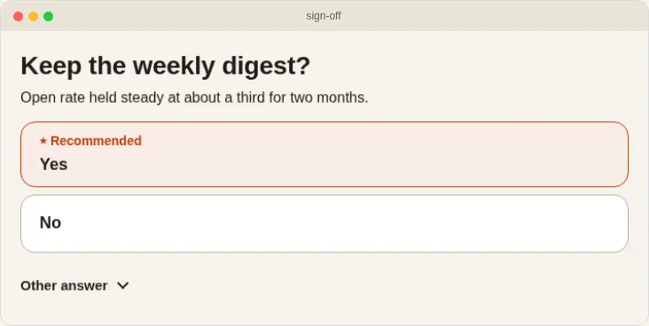

### Pick one, with a recommendation

```sh
sign-off-axi raise --title "When should the new settings page go out?" --option today=Today --option friday=Friday --option next-week="Next week" --recommend friday --default next-week
```

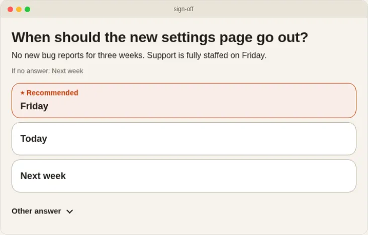

### Design pick, with mocks A/B/C

```sh
sign-off-axi post --type design --title "Pick the settings layout" --option a="Layout A" --option b="Layout B" --mock a=mocks/a.html --mock b=mocks/b.html --tradeoff "A is fastest to tap; B shows both choices." --recommend b
```

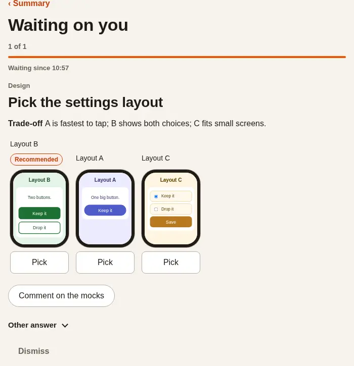

### Proof update, with Pass / Fail / Needs work

```sh
sign-off-axi post --type evidence --title "Settings page loads in a second" --about "Umer opens the new page on a phone." --media shot-light.png --media shot-dark.png
```

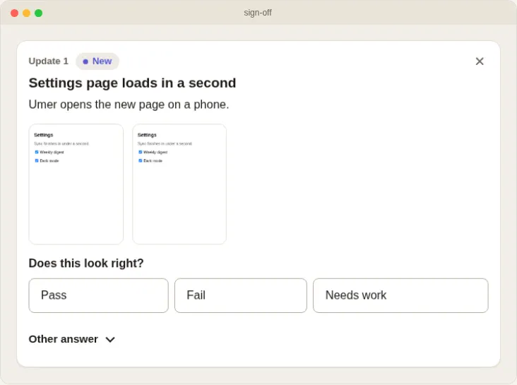

### Explainer video, with chapters

```sh
sign-off-axi post --type explainer --title "Is the new sign-in clear?" --about "Two steps: password, then a code." --media explainer.mp4 --chapter 0:00=Start --chapter 0:02="The code step"
```

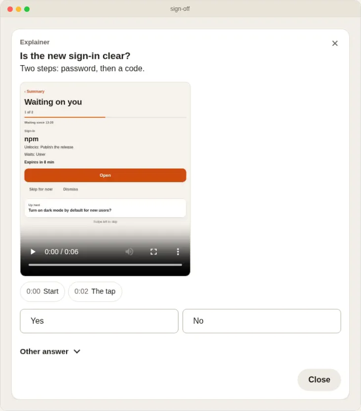

### Explainer page, to read

```sh
sign-off-axi report init .sign-off/mocks/sign-in-flow   # writes the page to fill
sign-off-axi post --type report --title "Sign-in now takes 2 steps" --about "Why the code step moved first." --view mocks/sign-in-flow/index.html --preview mocks/sign-in-flow/preview.svg
```

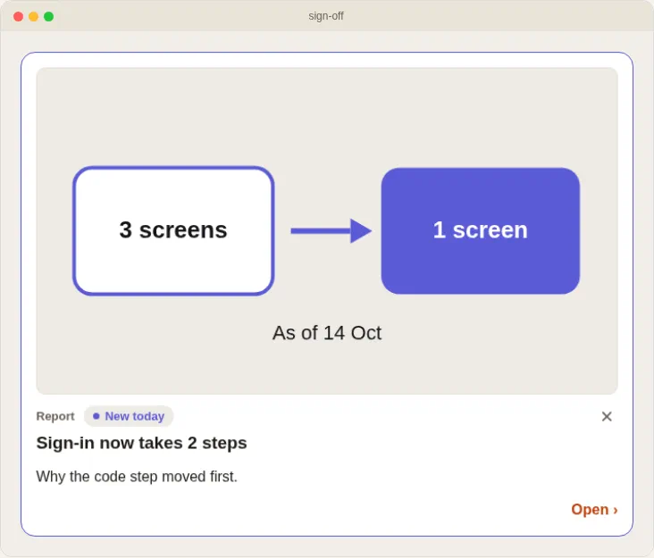

### Diagram

```sh
sign-off-axi post --type diagram --title "Is this the sign-in flow?" --view flow.svg --recommend yes
```

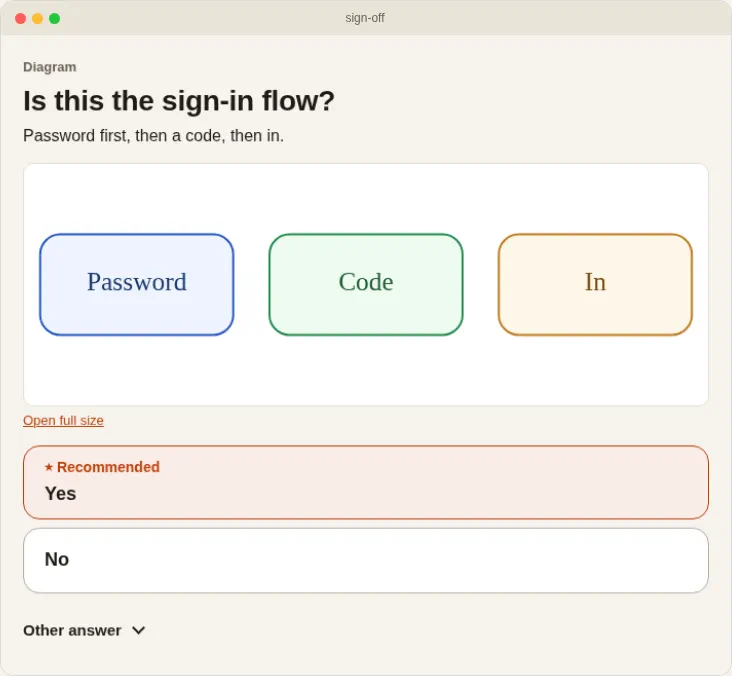

### Interactive page

```sh
sign-off-axi post --type interactive --title "How many testers approved?" --view counter.html --recommend yes
```

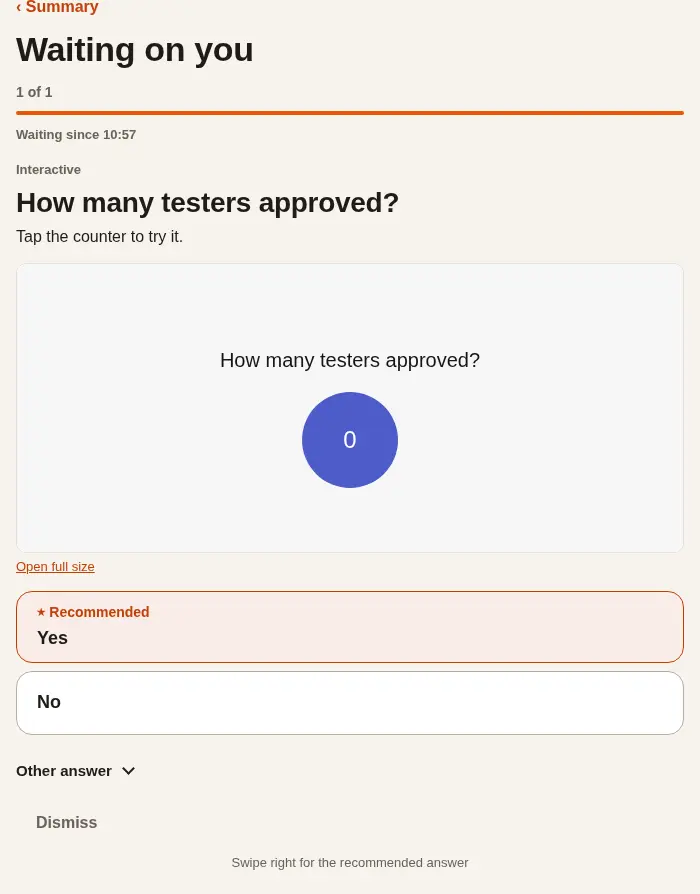

### Sign-in link

```sh
sign-off-axi post --type signin --service "npm" --link https://example.com/sign-in/abc123 --unlocks "Publish the release" --waits "Umer" --expires 15m --key npm-login
# later, when it worked:
sign-off-axi signin done --key npm-login
```

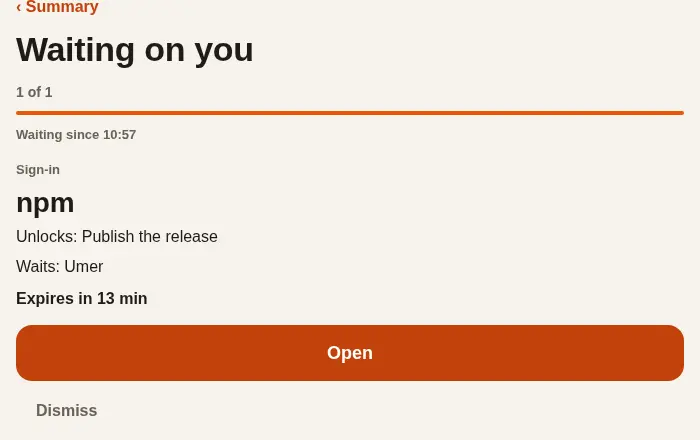

### Release gate

```sh
sign-off-axi post --kind gate --from gate.json   # holds a run for the user: Approve or Fix first
```

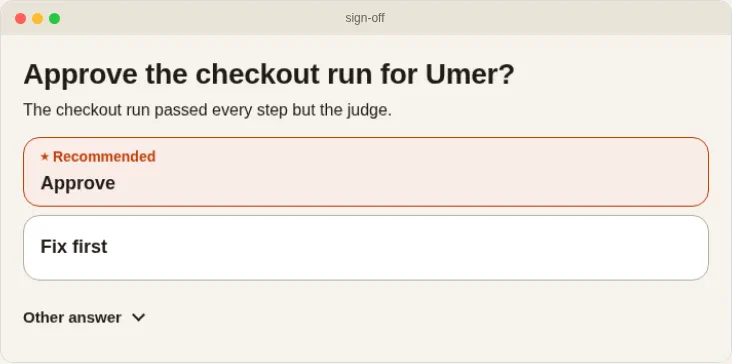

### Retro finding

```sh
sign-off-axi post --kind finding --from finding.json   # asks the user to Apply or Skip a proposed fix
```

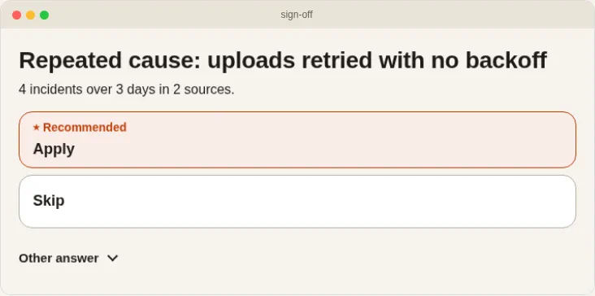

## Phone

The same board on a phone, light and dark. Mock frames swipe sideways; videos
and recordings play inline.

<p>
  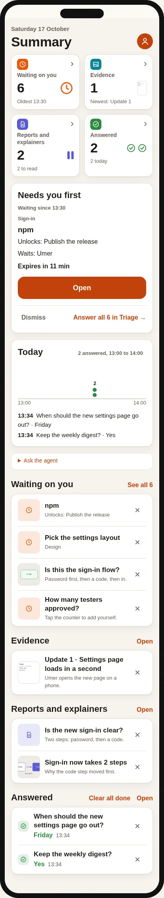
  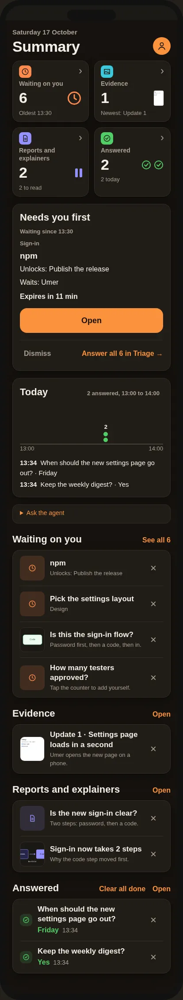
</p>

## On your screen

The waiting list and the summary in dark, from the same demo board.

<p align="center">
  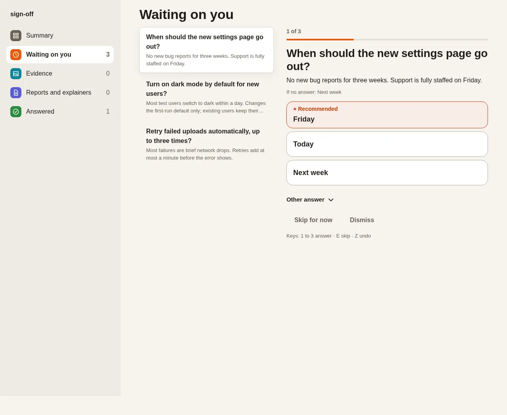
</p>

<p align="center">
  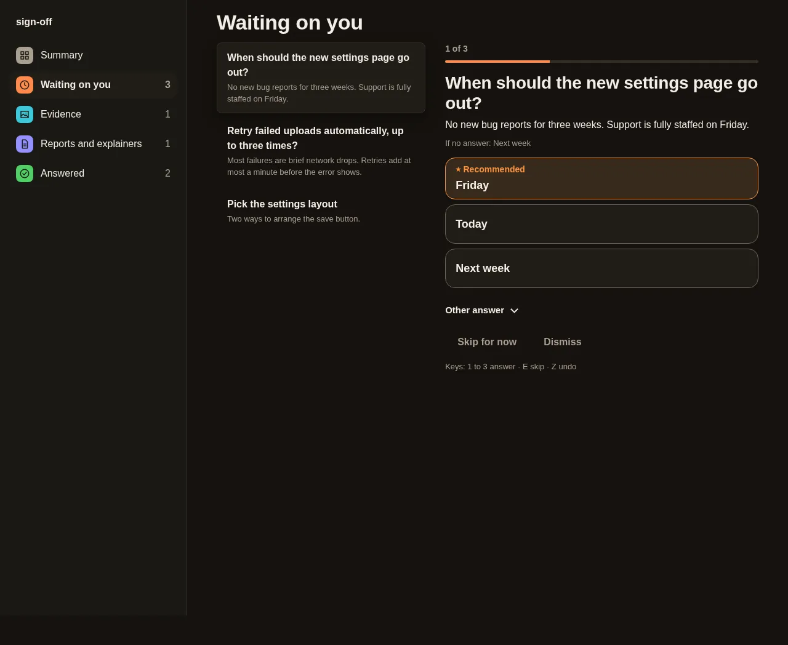
</p>

<p align="center">
  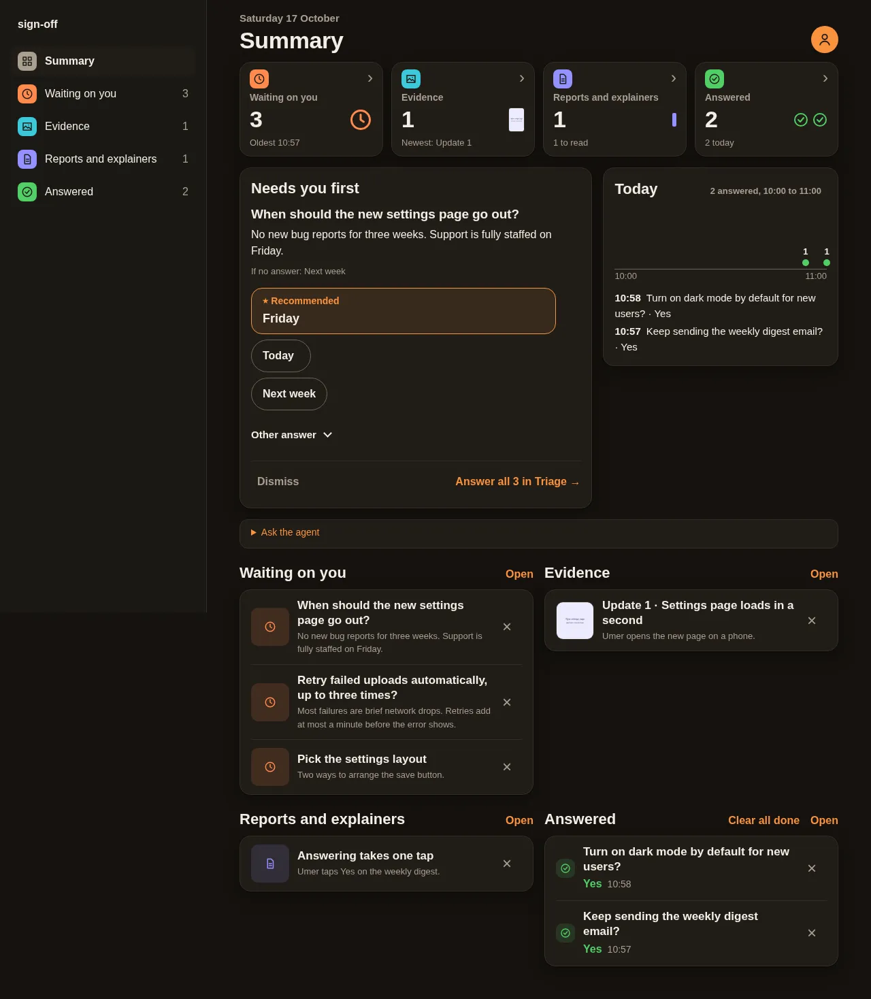
</p>

## Commands

Every command takes `--help`. Output is compact, with next-step hints.
The CLI is driven from a shell with no setup; sign-off itself calls no model
and inherits the calling agent's model routing.

| Command | In a few words |
|---|---|
| `list` | show what is waiting on you |
| `raise` | ask a yes/no or pick-one question |
| `post` | ask any kind, or post a contract message |
| `answers` | read the saved answers |
| `wait` | block until the user answers |
| `poll` | block until a comment or prompt arrives |
| `open` | start the board in the background |
| `status` | is this board's server running? |
| `stop` | stop this board's server |
| `serve` | run the board in the foreground |
| `export` | freeze the board as one HTML file |
| `init` | set up a repo and install agent skills |
| `report` | build an explainer page to post |
| `signin` | close a sign-in card as done |
| `doctor` | check the setup; each failure names its fix |
| `validate` | check messages against the contract |
| `update` | upgrade the CLI (`--check` reports only) |

```
$ sign-off-axi raise --title "Keep the weekly digest?" --recommend yes
board: ~/.sign-off/decisions.json
raised[1]{key,status,title}:
  keep-the-weekly-digest,raised,Keep the weekly digest?
help[2]:
  Run `sign-off-axi open` so the user can answer
  Run `sign-off-axi answers --key keep-the-weekly-digest` to read the answer
```

Exit codes: `0` ok, including no-ops; `1` the request cannot be done;
`2` usage or input error. Errors print on stdout as `error:`, `code:` and
`help:` lines.

## Agent setup

In a project folder, one command writes `.sign-off/` (config, board,
`mocks/` and `evidence/` folders) and installs the sign-off skill for each
coding agent on your `PATH`:

```sh
npx -y sign-off-axi init
```

| Agent | `--agent` name | Detected by | Skill folder in the project |
|---|---|---|---|
| Claude Code | `claude-code` | `claude` | `.claude/skills/` |
| Codex | `codex` | `codex` | `.agents/skills/` |
| OpenCode | `opencode` | `opencode` | `.agents/skills/` |
| Pi | `pi` | `pi` | `.agents/skills/` |
| Gemini CLI | `gemini-cli` | `gemini` | `.agents/skills/` |

The skill teaches the agent to ask through `npx -y sign-off-axi` and stays a
short stub pointing at `--help`, so it cannot go stale. `doctor` checks the
setup; `open` and `serve` use the config's `port:` unless `--port` is given.

Every item records who filed it, and that agent gets the answer as an event,
by itself:

```sh
sign-off-axi raise --title "Keep the weekly digest?" --filer my-agent   # or export SIGN_OFF_FILER=my-agent
sign-off-axi wait --filer my-agent                                      # blocks until you answer, then prints it
```

`wait --filer` returns only that filer's answers, each once, and the card
shows **Seen by agent**. An agent that cannot block can be woken instead:
an `on_answer:` line in the `config.yaml` beside the board names a command
the board runs for every answer. Detail in
[docs/question-kinds.md](docs/question-kinds.md).

## Development

```sh
npm test                      # builds, then runs the integration journeys against the real CLI and server
npm run build:skill           # regenerates skills/sign-off-axi/SKILL.md from src/skill.ts (CI runs it with -- --check)
npm pack                      # builds the publishable sign-off-axi tarball
```

A release is a merged version-bump PR: CI publishes the new version to npm.

### Test runs never touch your board

With no board named, a bare command uses the nearest `.sign-off/` that
`init` set up, looking from the working folder up to its repo root (the
folder holding `.git`) or up to HOME, but never HOME's own `.sign-off/`.
Otherwise the default board is `~/.sign-off/decisions.json`, under
`SIGN_OFF_HOME` when it is set. A test or agent run that must not reach your
own board sets HOME and every `XDG_*` folder to one fresh temporary folder,
or sets `SIGN_OFF_HOME` to one. A board file named on the command line
always wins.

```sh
tmp=$(mktemp -d)
(cd "$tmp" && SIGN_OFF_HOME="$tmp" sign-off-axi raise --title "Probe?")   # lands in $tmp/.sign-off/decisions.json
```

Proof lives in [`.done-done.yaml`](.done-done.yaml): the `install`, `test`
and `skill` journeys re-run every check the CI gate enforces, and CI calls
them through `done-done run`.

Write your own questions using the [file-format reference](docs/file-formats.md).
