<p align="center">
  <picture>
    <source media="(prefers-color-scheme: dark)" srcset="docs/logo-dark.svg">
    
  </picture>
</p>

<h1 align="center">sign-off</h1>

Guided plans and reports now offer **Simplify this** under each part (and for any words you select inside one paragraph): the same owner explains it in place, with pending and persistent **New** states. New defaults require a filer; older documents still load. [Owner setup and engagement contract](docs/contract.md#report-schema-4-and-plan-schema-3-engagement-v1).

<p align="center"><b>One calm page for every question the programs working for you need answered.</b><br>Agents ask; you answer with one tap on your own machine; the answer is saved for the asker to read. Proof of finished work lands on the same page, so you check it instead of taking anyone's word.</p>

<p align="center"><b>▶ <a href="https://umeranjum17.github.io/sign-off/demo/">Try it live</a></b>: the real board on demo data. No install, nothing leaves your browser. · <a href="https://umeranjum17.github.io/sign-off/">Website</a></p>

<p align="center">
  <picture>
    <source media="(prefers-color-scheme: dark)" srcset="docs/media/desk-today-dark.webp">
    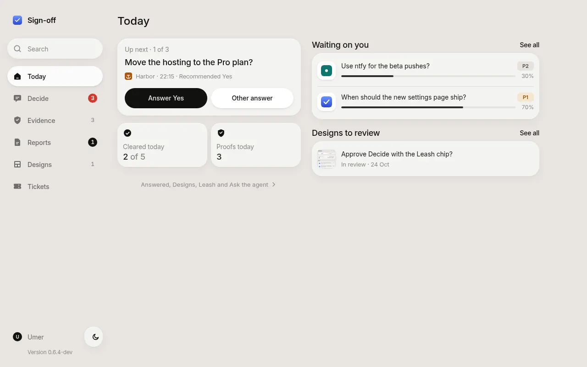
  </picture>
</p>

## Install in 3 steps

```sh
npm install -g sign-off-axi          # 1. install from npm
npx -y sign-off-axi init             # 2. in your project: set up .sign-off/ and the agent skill
sign-off-axi open                    # 3. start the board and open the printed link
```

Then ask your first question, the way an agent would, and answer it on the board:

```sh
sign-off-axi raise --ask-ref message-example \
  --title "Keep the weekly digest?" \
  --why "The paid plan renews Monday." \
  --outcome yes="It keeps going out." --outcome no="It stops this week." \
  --recommend yes --recommend-reason "Readers still open it." --default yes
sign-off-axi answers --key keep-the-weekly-digest   # read the tap back
```

You need Node 22.5 or newer. `init` installs the skill for each coding agent it finds on your `PATH`; `sign-off-axi --help` lists every command, and every command takes `--help`.

## The board

Four places, in the bar at the bottom of a phone and the sidebar on a desk.

The board installs as an app (More, then Install app; on an iPad, Share, then Add to Home Screen) and, once opened, reads offline: with the board unreachable it shows the last update under "Offline, showing the last update", and sends fail rather than queue. A phone needs the board on HTTPS or localhost to install it.

<table>
  <tr>
    <td align="center" width="25%"><picture><source media="(prefers-color-scheme: dark)" srcset="docs/media/phone-today-dark.webp">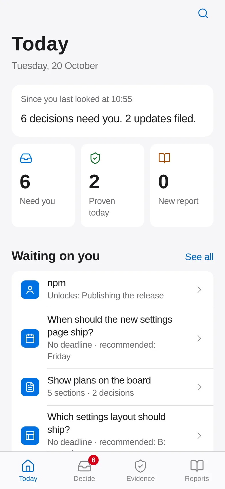</picture><br><b>Today</b><br>What needs you, what was proven, what is new.</td>
    <td align="center" width="25%"><picture><source media="(prefers-color-scheme: dark)" srcset="docs/media/phone-decide-dark.webp">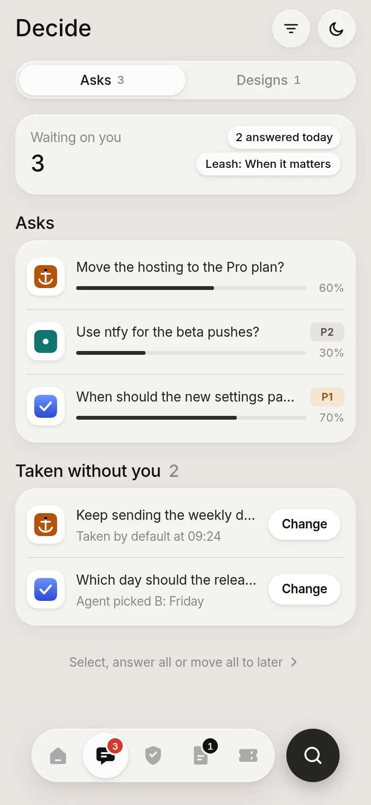</picture><br><b>Decide</b><br>Every ask that waits on you, one tap each.</td>
    <td align="center" width="25%"><picture><source media="(prefers-color-scheme: dark)" srcset="docs/media/phone-evidence-dark.webp">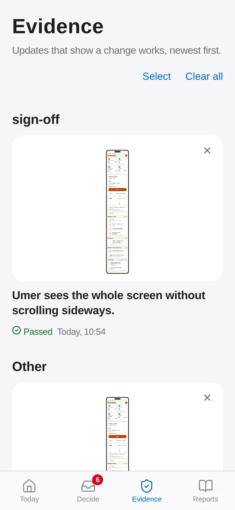</picture><br><b>Evidence</b><br>Proof that a change works, with its honest result.</td>
    <td align="center" width="25%"><picture><source media="(prefers-color-scheme: dark)" srcset="docs/media/phone-reports-dark.webp">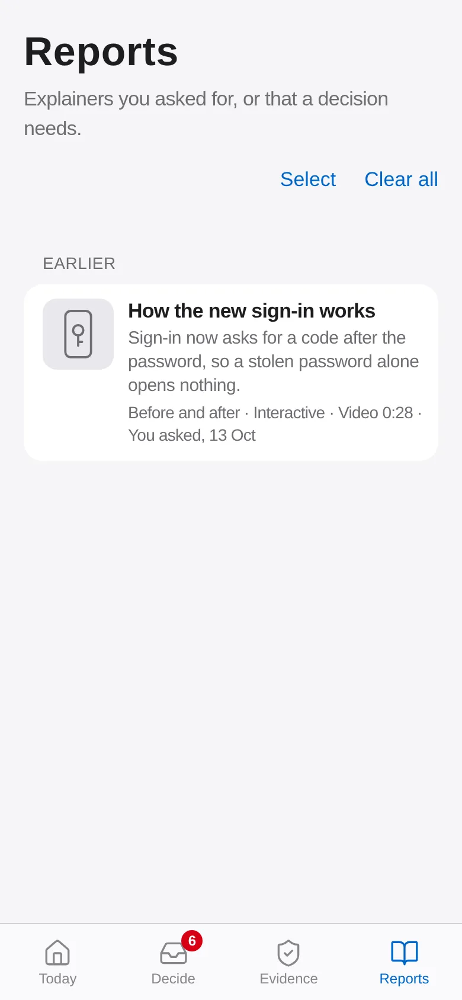</picture><br><b>Reports</b><br>Explainers you asked for, to read.</td>
  </tr>
</table>

### Evidence is not a decision

**Decide** holds only real asks: things an agent cannot do without your answer. **Evidence** holds proof (screenshots or a short recording of the running product) with the result of the check that made it: Passed, Not run, Failed, Did not finish or Could not check. A proof update is never counted as something that needs you; you can give it a verdict (Pass, Fail or Needs work) or dismiss it. **Today** counts the two separately: what needs you, and what was proven today.

### Plans and reports, on their own pages

<table>
  <tr>
    <td align="center" width="33%"><picture><source media="(prefers-color-scheme: dark)" srcset="docs/media/phone-plan-dark.webp">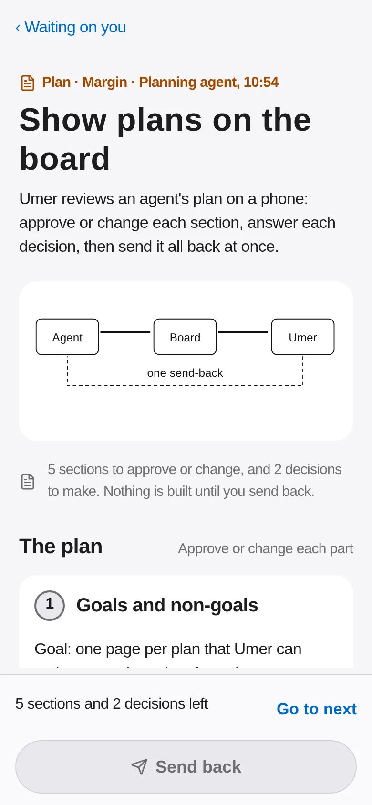</picture><br><b>Plan</b><br>Approve or change each section, answer each decision, send it all back at once.</td>
    <td align="center" width="33%"><picture><source media="(prefers-color-scheme: dark)" srcset="docs/media/phone-report-dark.webp">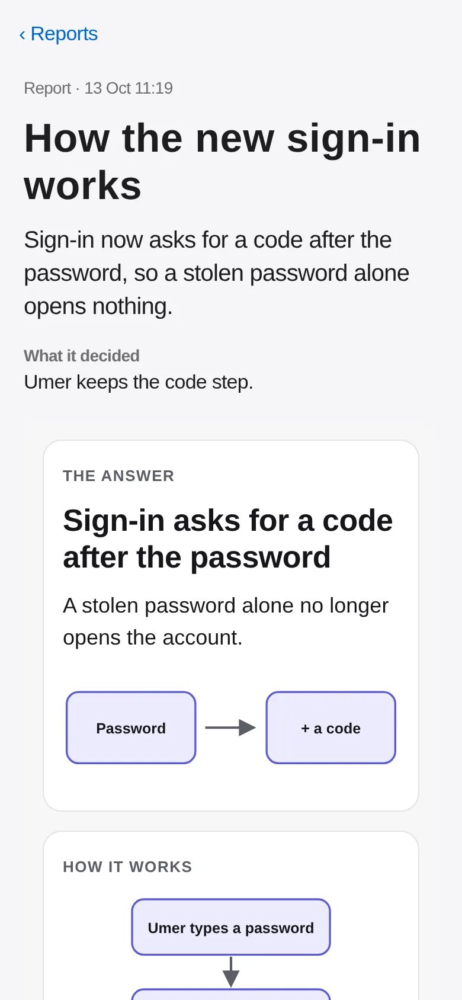</picture><br><b>Report</b><br>An explainer page: the answer first, then a diagram and steps to tap through.</td>
    <td align="center" width="33%"><picture><source media="(prefers-color-scheme: dark)" srcset="docs/media/phone-signin-dark.webp">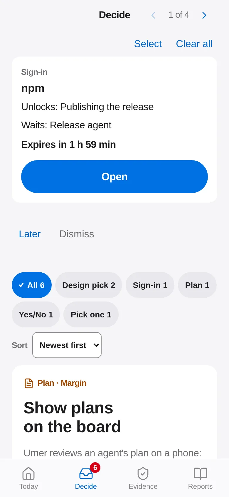</picture><br><b>Sign-in</b><br>An agent needs you to log in: tap Open, then it carries on.</td>
  </tr>
</table>

A plan is what an agent wants to do before it starts. A report is an explanation you asked for. Both open over the board, and the board, not the agent's page, owns the answer buttons. A **sign-in card** goes to the top of Decide with the service, what it unlocks, who is waiting and the time left on the link; the agent closes it with `sign-off-axi signin done`.

### It keeps only what matters

A board that fills up with noise stops being read, so the rules sit at the door.

- A question must say why it is asked, what each answer does, which one the agent recommends and what happens if you stay quiet; one that does not is refused with the fix ([the question standard](docs/contract.md#ask-schema-1)).
- One decision is one card: raising the same question again changes nothing, and `--merge <key>` folds an older card into the better-asked one.
- Proof posted as a Pass/Fail question is refused, and proof that is mostly text, a placeholder or a test card is refused too: proof goes to Evidence, as a capture of the real product; a report must be a page to tap, not a wall of words.
- **Discard** takes a card off the board with one tap on a reason (Not relevant, Replaced by newer or Done elsewhere): it moves to **Archived**, **Undo** brings it back for 10 seconds, and its agent is told why once those 10 seconds are over. **Select** in Decide and Designs discards several at once, and **Restore** under Archived brings one back (`sign-off-axi dismiss <key> --reason replaced` and `restore <key>` do the same from a shell; without `--reason`, `dismiss` hides a card and tells no one). `sign-off-axi dismiss --filer <id>` closes a finished task: every card that id still waits on leaves the board. Reports leave the main view a day after they were filed and wait under **Archived**; nothing is deleted, and Restore brings one back. Evidence stays on its screen for good, newest first, until dismissed. Posting an evidence message again under its key, from the same filer, replaces the card. A new ask that repeats an open ask on the same decision is refused, and answering one closes its twins.

### One ticket ties a task's cards together

A ticket is one piece of work, with a title and how far along it is, and optionally its priority, its project and whether it is on hold. Tickets nest: an epic has tickets, a ticket has sub-tasks, and each is as far along as what is under it. The **Tickets** tab shows your asks (and the system's own work) done, in progress, on hold and to do. Post any card with `--ticket <id>` (an ask, a design, proof, a report or a plan) and its screen shows a **Ticket** row (on an ask, **Its ask** in the panel under the question) with the ticket's title and progress; tap it for the ticket, which lists the tickets under it and every card on it, newest first, with their Activity. It is optional and only a link: a card without one, or naming a ticket the board has not got, works exactly as before.

```sh
sign-off-axi ticket --id T-29 --title "Ship the new settings page" --progress 40
sign-off-axi post --type evidence --ticket T-29 --title "Settings on a phone" --about "Umer changes the theme in one tap." --media shot.png
```

Agents pass `--ticket` whenever they know the ticket their work belongs to, and move its `--progress` as the work goes; the shipped skill tells them so.

### How urgent, and whose project

A card may say how urgent it is with `--priority P0` (most urgent) to `P3` (least), on any `raise` or `post`; it shows as a chip, and a card without one shows none. A project may have its own icon: a picture in the board's folder (.png, .jpg, .webp or a script-free .svg, 500 KB or less), set once. The board serves only that exact file, and a project with no icon shows its initials.

```sh
sign-off-axi raise --priority P1 --title "Ship the new settings page this week?" ...
sign-off-axi project --name Beacon --icon icons/beacon.png
```

Agents pass `--priority` when they know it, and set their project's icon when it ships one; the shipped skill tells them so.

Every card's screen also keeps its **Activity**, oldest first, from what the board already saved: who posted it, your answer and note (and the one a change replaced), when the agent picked it up, a new round you asked for and your comments. A ticket's page shows its cards' activity together.

### The leash: what agents may do without you

Every ask says what happens if you stay quiet (`--default`) and when (`--silent-by`). Your leash decides whether it happens. Set it in Today's More, or tap the **Leash** chip by the count on Decide. It is saved as `leash:` in the `config.yaml` beside the board.

- **Ask me first** (`ask`): nothing happens; agents wait for you on every ask.
- **When it matters** (`matters`, the default): when an ask's `--silent-by` time passes with no answer, the open board takes its default as the answer. Its card says **Taken by default at 13:00**, and the waiting agent gets it at once. A default that fell due while the board was closed is taken when it starts. An ask with no `--silent-by` waits.
- **Act, then tell me** (`act`): the agent's recommended pick is taken the moment it raises the ask. Its card says **Agent picked B: Friday, tell me if wrong**.

Both kinds wait under **Taken without you** in Decide until you open them, each with a one-tap **Change** on a phone. You can still answer or change them. The change reaches the agent as an answer that replaces the taken one, and the card's trail and Activity say what happened: Taken or Picked, then Delivered and Read.

Some asks are never answered for you, whatever the leash: an ask raised with `--guard destructive|irreversible|money|credential|security`, and an ask whose words talk of spending money, deleting, what can't be undone, passwords and keys, or access. Designs, plans and sign-ins always wait too. Such an ask says **Always waits for you** and why.

<table>
  <tr>
    <td align="center" width="33%"><picture><source media="(prefers-color-scheme: dark)" srcset="docs/media/phone-leash-decide-dark.webp">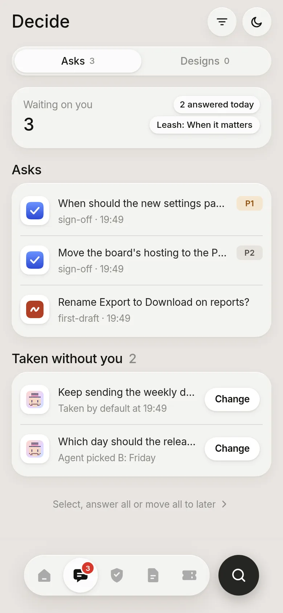</picture><br><b>Taken without you</b><br>What the leash answered, with Change.</td>
    <td align="center" width="33%"><picture><source media="(prefers-color-scheme: dark)" srcset="docs/media/phone-leash-agent-dark.webp">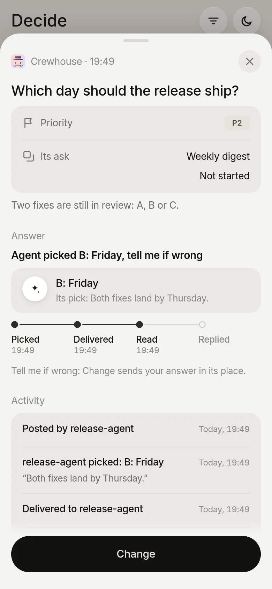</picture><br><b>Agent picked</b><br>On Act, then tell me: its pick, and Change.</td>
    <td align="center" width="33%"><picture><source media="(prefers-color-scheme: dark)" srcset="docs/media/phone-leash-guard-dark.webp">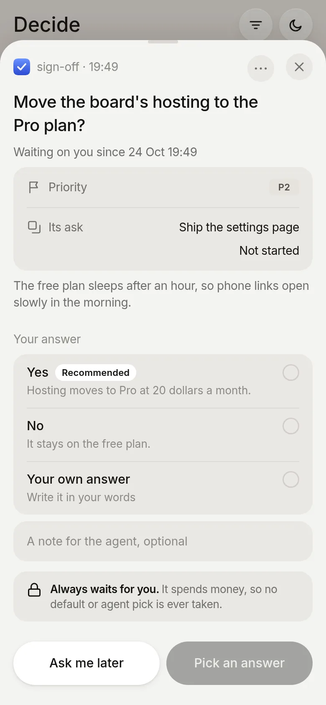</picture><br><b>Always waits for you</b><br>Money, deletes, keys and access.</td>
  </tr>
</table>

## What you can ask

One line on what the agent runs per kind; the full reference is [docs/question-kinds.md](docs/question-kinds.md) and the message rules are in [docs/contract.md](docs/contract.md).

| Kind | The agent runs | You see |
|---|---|---|
| Yes or no, pick one | `raise --ask-ref <captain-message-id-or-hold-id> --title ... --recommend ...` | buttons, the recommended one first |
| Design pick (mocks A/B/C) | `post --type design --mock a=... --mock b=... --link a=<url>` | mocks side by side, an Open live link under each option that has a `--link`, a note on any part, and Open full screen: the prototype over the whole screen with its own navigation, Phone or Desktop width and another option as a reference |
| Design review (one plain question) | `post --kind design --from design.json` | one question answered with **Yes** (a note optional) or **Change** (a note needed): each screen's frames side by side (Before and After, or Today, New and Target design), the changed area outlined and named on each and the frame Yes approves marked; post refuses an internal title and frames that look the same. Nothing in Decide: it waits under **Designs** for Main to review, and Main's `promote <key>` puts it in Decide |
| Proof update | `post --type evidence --media shot.png` | the capture, its result, Pass / Fail / Needs work |
| Proof with a file to install | `post --type evidence --media shot.png --attach app.apk` | the capture, and the file with its size and a Download button (any type, up to 1 GB, `SIGN_OFF_ATTACH_MAX_MB` to change) |
| Explainer video | `post --type explainer --media clip.mp4 --chapter 0:00=Start` | a player with chapter buttons, then Yes or No |
| Report | `report init <folder>`, fill `report.json`, then `post --kind report --from <folder>/report.json` | one scroll: the answer and a picture, what I understood, what I found, the next step; numbers under their part, one bar (Agree, Disagree, Comment, Ask) that acts on the part in view, and one Activity of every note, ask, reply and read |
| Diagram, interactive page | `post --type diagram --view flow.svg` | the picture on the card; interactive pages run sandboxed, and open full screen at phone or desktop width |
| Plan | `report init <folder> --plan`, fill `plan.json`, then `post --kind plan --from plan.json` | the same scroll, plus each decision with my pick and a Go ahead |
| Sign-in link | `post --type signin --service npm --link <url> --unlocks ...` | an Open button and the time left |

## How agents use it

Every item records who filed it. The agent raises with `--filer my-agent`, then blocks on `sign-off-axi wait --filer my-agent`, which returns that filer's answers, each once, and the card shows **Seen by agent**. An agent that cannot block can be woken instead: an `on_answer:` line in the `config.yaml` beside the board names a command the board runs for every answer, and a `notify:` block can send an HTTP POST when a card enters Decide. The worked examples are in [docs/commands.md](docs/commands.md).

For Go deeper on a guided plan or report, an idle **Claude Code** author can opt in to native session resumption: register its actual UUID with `owner --filer <id> --host claude --session <UUID> --cwd <absolute project folder>`, then run a separate `owner --dispatch --timeout 3600` process for the same board. `owner` shows queued delivery failures and distinguishes delivered from owner-read. No Firstmate is needed; other hosts are not supported for this wake path. See the [standalone owner recipe](docs/commands.md#standalone-go-deeper-owner).

Each ordinary sign-off command calls no model; the opt-in dispatcher invokes the installed Claude Code with its normal credentials and optional registered model. The shipped skill is deliberately thin: it tells the agent how to write a good card and defers to `sign-off-axi --help` for every flag, so an installed copy never goes stale.

## Works alone, or with its siblings

sign-off stands alone: the CLI and the skill need no other tool and no supervisor. They connect through one small written contract ([docs/contract.md](docs/contract.md)):

- **done-done** (verification) posts its proof as Evidence and holds a run for your Approve or Fix first as a gate.
- **learn-from-mistakes** (retros) posts each proposed change as a finding for you to Apply or Skip.
- **first-draft** (design) writes its review links into a design card, shown as real links to open the mock-up.
- **An agent supervisor**, such as Firstmate, or a lone agent in a terminal: both post the same asks, plans and reports and read the same answers.

## Docs and reference

- [Commands](docs/commands.md): every command, the agent setup, exit codes.
- [Question kinds](docs/question-kinds.md): the reference for each kind.
- [Contract](docs/contract.md): the message rules agents post by.
- [File formats](docs/file-formats.md): board and message files.
- [Vision](VISION.md): who sign-off is for and where it is going.

## Development

Builds first, then runs the integration journeys against the real CLI:

```sh
npm test
npm run build:skill
npm run build:demo
npm pack
```

- `npm test`: full journeys
- `npm run build:skill`: writes the skill from `src/skill.ts`
- `npm run build:demo`: the website (`site/`) and the demo board at `/demo/`, built into `demo-dist/`
- `npm pack`: tarball

A release is a merged version-bump PR: CI publishes the new version to npm.

Change what a user sees or runs, and update this README, the skill (`src/skill.ts`), the website (`site/index.html`) and any screenshot they show in the same PR.

### Test runs never touch your board

With no board named, a bare command uses the nearest `.sign-off/` that
`init` set up, looking from the working folder up to its repo root (the
folder holding `.git`) or up to HOME, but never HOME's own `.sign-off/`.
Otherwise the default board is `~/.sign-off/decisions.json`, under
`SIGN_OFF_HOME` when it is set. A test or agent run that must not reach your
own board sets HOME and every `XDG_*` folder to one fresh temporary folder,
or sets `SIGN_OFF_HOME` to one. A board file named on the command line
always wins.

```sh
tmp=$(mktemp -d)
export SIGN_OFF_HOME="$tmp"
(cd "$tmp" &&
  sign-off-axi raise --ask-ref message-example \
  --title "Probe?")
```

Proof lives in [`.done-done.yaml`](.done-done.yaml): the `install`, `test`
and `skill` journeys re-run every check the CI gate enforces, and CI calls
them through `done-done run`.

Write your own questions using the [file-format reference](docs/file-formats.md).
