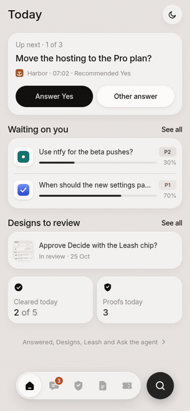
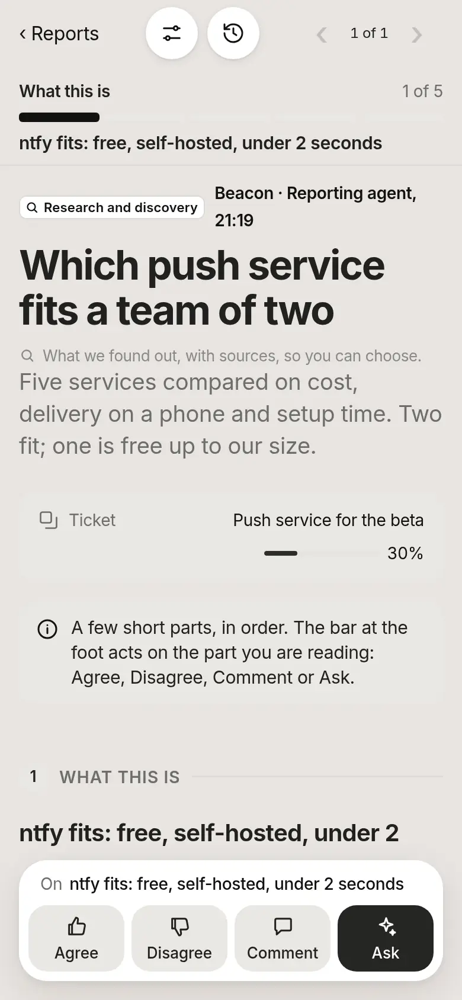
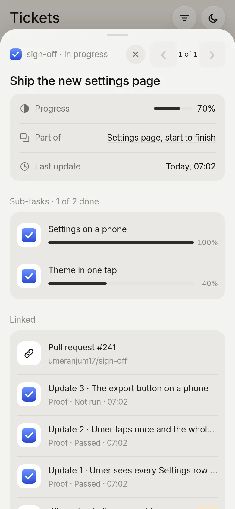

<p align="center">
  <picture>
    <source media="(prefers-color-scheme: dark)" srcset="docs/logo-dark.svg">
    
  </picture>
</p>
<h1 align="center">sign-off</h1>

<p align="center"><b>Answer your coding agents’ questions and review their work from one board.</b></p>

<p align="center">For people running coding agents. Read plans, pick designs, and check proof on your phone or desktop.</p>

<p align="center">
  <picture>
    <source media="(max-width: 600px) and (prefers-color-scheme: dark)" srcset="docs/media/phone-today-dark.webp">
    <source media="(max-width: 600px)" srcset="docs/media/phone-today.webp">
    <source media="(prefers-color-scheme: dark)" srcset="docs/media/desk-today-dark.webp">
    
  </picture>
</p>

## Quick start

Requires Node.js 22.5 or newer. Run in your project folder. This example installs the Codex skill; [choose another agent](docs/commands.md#agent-setup) if needed.

```sh
npm install -g sign-off-axi
sign-off-axi init --agent codex
sign-off-axi open
```

Open the printed link. Tell your agent to use the installed sign-off skill when it needs your answer.

[Try the demo](https://umeranjum17.github.io/sign-off/demo/) · [Website](https://umeranjum17.github.io/sign-off/) · [Commands](docs/commands.md) · [Agent skill](skills/sign-off-axi/SKILL.md)

[](https://www.npmjs.com/package/sign-off-axi) [](https://github.com/umeranjum17/sign-off/actions/workflows/ci.yml) [](LICENSE)

## Why sign-off

When several agents need you, questions get spread across terminals. sign-off collects them and saves each answer for its agent.

| Your current workflow | With sign-off |
| --- | --- |
| Find a question in each terminal | Today shows what needs you next |
| Type the same answer again | The agent reads your saved answer |
| Read “done” in chat | Open screenshots and recordings in Evidence |
| Explain which part needs changing | Comment on the part of a plan or report in view |
| Ask whether feedback arrived | See Sent, Delivered, Read, and Replied |

<p align="center"></p>

A real ask answered on the demo board. The capture journey checks that the CLI reads back **Friday**. The projects and work shown are demo data.

## What you get

<table>
<tr>
<td width="50%"><picture><source media="(prefers-color-scheme: dark)" srcset="docs/media/phone-decide-dark.webp"></picture><br><b>Answer what needs you.</b><br>Pick an answer, add a note, or ask for it later. The leash sets when agents may take a default; guarded asks always wait.</td>
<td width="50%"><picture><source media="(prefers-color-scheme: dark)" srcset="docs/media/phone-reader-dark.webp"></picture><br><b>Review the work in place.</b><br>Plans and report kinds have one action bar for the part in view. Ask the author to simplify a part. The report kit supports tables, video, comparisons, and a design gallery.</td>
</tr>
<tr>
<td><picture><source media="(prefers-color-scheme: dark)" srcset="docs/media/phone-evidence-dark.webp"></picture><br><b>Check the proof.</b><br>Open captures inline, or turn on Previews to see them all. Each proof carries its check result.</td>
<td><picture><source media="(prefers-color-scheme: dark)" srcset="docs/media/phone-tickets-dark.webp"></picture><br><b>Keep the task together.</b><br>Epics, tickets, and tasks roll up progress. Open their linked cards and Activity.</td>
</tr>
</table>

Every card has Previous and Next through its list. Feedback keeps its delivery trail. Discard asks for a reason and offers Undo; Archived keeps cards available to restore. The board installs as an app and reads its last update offline.

## Proof you can inspect

- [Live demo](https://umeranjum17.github.io/sign-off/demo/): the real board with demo data. No install; demo answers stay in your browser.
- [Published package](https://www.npmjs.com/package/sign-off-axi): version **0.6.8**. The quick start above was run against the published package in an empty scratch folder.
- [Capture recipe](.agents/skills/done-done-verify-sign-off/SKILL.md): the README pictures come from the real board at 390 and 1280 pixels, light and dark. The answer loop also checks the saved answer through the CLI.
- [Integration journeys](test/) and [CI runs](https://github.com/umeranjum17/sign-off/actions/workflows/ci.yml): checks you can inspect and rerun.

## Agent setup and limits

The CLI and skill work without a supervisor. Agents post cards and wait for their own answers. Each ordinary command calls no model. The optional Claude Code owner dispatcher resumes the author for follow-up questions.

The board runs on your machine. A phone needs a reachable address; [private network setup](docs/commands.md) explains binding and access tokens. Installing the app requires HTTPS or localhost. Offline mode shows the last update; sends fail and are not queued.

## More

- [Board guide](docs/board-guide.md): screens, feedback trail, Discard, the leash, tickets, and report kit.
- [Commands and setup](docs/commands.md): install details, agent choices, network access, and all flags.
- [Question kinds](docs/question-kinds.md) · [Message contract](docs/contract.md) · [File formats](docs/file-formats.md).
- [Vision](VISION.md) · [Version history](https://github.com/umeranjum17/sign-off/tags).

## Contributing

```sh
npm install
npm test
npm run build:skill
```

Use an isolated board for tests. See the [development notes](docs/board-guide.md#development) and [verification skill](.agents/skills/done-done-verify-sign-off/SKILL.md).

[MIT license](LICENSE).
