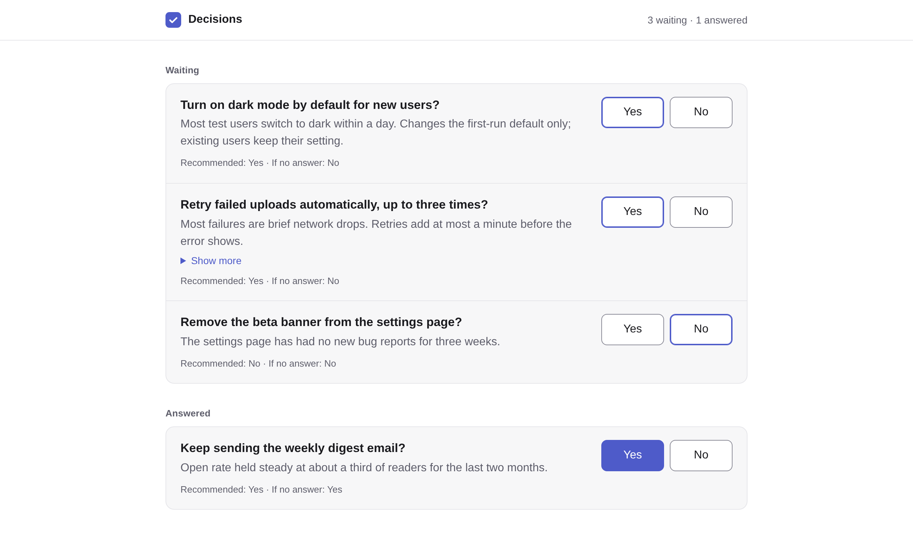
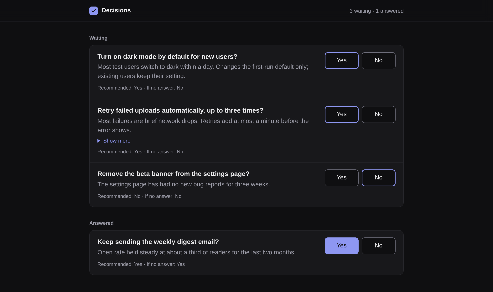

<p align="center">
  
</p>

<h1 align="center">sign-off</h1>

<p align="center"><b>Answer your agents' yes/no questions in one click, from a page on your own machine.</b></p>

<p align="center">
  <picture>
    <source media="(prefers-color-scheme: dark)" srcset="docs/media/desktop-dark.png">
    
  </picture>
</p>

## Why

Agents stop and ask: ship this, keep that, turn this on? Those questions scatter across terminals and chats, and an answer typed in the wrong place gets lost.

sign-off puts them on one calm list. The agent writes a small JSON file, you click **Yes** or **No**, and the answer is saved next to the file for the agent to read. It runs only on `127.0.0.1`: no account, no hosting, no runtime dependencies.

- **One click.** Each question shows what the agent recommends and what happens if you stay silent. sign-off only shows that default; it never answers for you.
- **Nothing lost.** Every answer is appended to a file before the page confirms it, so it survives a reload and a server restart. Change your mind with one more click.
- **Phone and desktop, day and night.** It follows your system theme and fits a narrow phone screen with large text.

## Screenshots

| Phone, light | Phone, dark |
|---|---|
|  |  |
| **Desktop, light** | **Desktop, dark** |
|  |  |

## Quick start

sign-off is not on npm yet. Run it from this repository (Node 22.5 or newer):

```sh
# 1. Build
git clone https://github.com/umeranjum17/sign-off && cd sign-off && npm install && npm run build

# 2. Open the page with the demo questions (copy them so the answers stay out of the repo)
cp fixtures/demo-decisions.json /tmp/decisions.json
node dist/cli.js serve /tmp/decisions.json       # prints http://127.0.0.1:4410/

# 3. Click an answer, then read it back the way an agent would
node dist/cli.js answers /tmp/decisions.json     # {"weekly-digest":{"answer":"yes",...}}
```

## Commands

```
sign-off serve <decisions.json> [--port 4410]   show the page on 127.0.0.1 (--port 0 picks a free port)
sign-off answers <decisions.json>               print the latest answer per question as JSON
sign-off help
```

Exit codes: `0` ok, `2` usage or input error (the message names the item, key and field).

## File formats

**Questions**, written by the agent (`decisions.json`):

```json
{
  "schema": 1,
  "decisions": [
    {
      "key": "dark-default",
      "title": "Turn on dark mode by default for new users?",
      "about": "Most test users switch to dark within a day.",
      "detail": "Changes the first-run default only.",
      "recommend_value": "yes",
      "default_if_silent": "no"
    }
  ]
}
```

- `key`: 1-128 of `A-Z a-z 0-9 . _ -`, unique in the file. `title`: required.
- `options`: optional; only `yes` and `no` for now, each with a `label`.
- `recommend_value`, `default_if_silent`: optional, `yes` or `no`. Shown, never applied.
- `close`: optional, `done` (default) or `release`; copied into the answer.
- `type`: optional, `decision` only. Other keys are ignored.

**Answers**, written by sign-off next to the questions (`decisions.answers.jsonl`, mode 600, one line per click, the latest line per key wins):

```json
{"key":"dark-default","answer":"yes","label":"Yes","close":"done","at":"2026-10-11T09:14:03Z"}
```

`*.answers.jsonl` is git-ignored here so an answer is never committed by accident.

## Development

```sh
npm test    # builds, then runs the integration journey against the real CLI and server
```

Browser proof lives in [`.agents/skills/verify-sign-off`](.agents/skills/verify-sign-off/SKILL.md).
